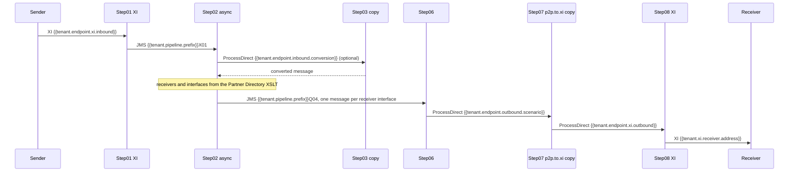

# Overview

## Purpose

In the SAP pipeline concept every message passes the same generic iFlows; what differs per scenario is read at runtime from the Partner Directory under the message's partner ID [com.sap.integration.cloud.pipeline.v2.generic.step02.inbound.processing, scripts/determinePartnerID.groovy#L342] [com.sap.integration.cloud.pipeline.v2.generic.step02.inbound.processing, scripts/readBypassOptionFromPD.groovy#L22] or sits in template copies the generic iFlows call by ProcessDirect [com.sap.integration.cloud.pipeline.v2.generic.step06.outbound.processing, adapter "ProcessDirect" "Receiver"]. SAP's change logs record its updates of the generic iFlows [generic-pipelines/CHANGELOG.txt#L6]. The concept carries the PI/PO way of processing, asynchronous above all, to Cloud Integration [rationale, from analysis 2026]. Generic iFlows are deployed once and shared; a scenario deploys only its entries and copies [rationale, from analysis 2026]. This knowledge base describes it from its artifacts, for agents that turn a PO Integrated Configuration or a point-to-point iFlow into a pipeline scenario.

## Message path

Integrated-async main path, XI sender to XI receiver:

1. Step01 XI receives on its XI sender adapter at `{{tenant.endpoint.xi.inbound}}` [com.sap.integration.cloud.pipeline.v2.generic.step01.inbound.processing.xi, adapter "XI" "Sender"] [com.sap.integration.cloud.pipeline.v2.generic.step01.inbound.processing.xi, parameter "XIEntryPoint"] and writes an ExactlyOnce message to the Partner Directory `InboundQueue` or to `{{tenant.pipeline.prefix}}` plus DefaultJMSQueueNumber [com.sap.integration.cloud.pipeline.v2.generic.step01.inbound.processing.xi, step 23 "QoS?"] [com.sap.integration.cloud.pipeline.v2.generic.step01.inbound.processing.xi, step 30 "Which queue?"] [com.sap.integration.cloud.pipeline.v2.generic.step01.inbound.processing.xi, scripts/readInboundQueueFromPD.groovy#L21] [com.sap.integration.cloud.pipeline.v2.generic.step01.inbound.processing.xi, adapter "JMS" "InboundProcessingQueue"] [com.sap.integration.cloud.pipeline.v2.generic.step01.inbound.processing.xi, adapter "JMS" "DefaultInboundProcessingQueue"]; X01 is the queue of Step02 async [com.sap.integration.cloud.pipeline.v2.generic.step02.integrated.messaging.async, adapter "JMS" "InboundProcessingQueueX"].
2. Step02 async calls an inbound conversion copy when one is configured [com.sap.integration.cloud.pipeline.v2.generic.step02.integrated.messaging.async, step 35 "Conversion?"] [com.sap.integration.cloud.pipeline.v2.generic.step02.integrated.messaging.async, adapter "ProcessDirect" "ReceiverConvert"].
3. It fetches the XSLT `receiverDetermination` [com.sap.integration.cloud.pipeline.v2.generic.step02.integrated.messaging.async, step 53 "Get XSLT mapping from Partner Directory"], splits the result per receiver and per interface [com.sap.integration.cloud.pipeline.v2.generic.step02.integrated.messaging.async, step 83 "Split receivers"] [com.sap.integration.cloud.pipeline.v2.generic.step02.integrated.messaging.async, step 67 "Split interfaces"] and writes `{{tenant.pipeline.prefix}}Q04` [com.sap.integration.cloud.pipeline.v2.generic.step02.integrated.messaging.async, adapter "JMS_OuboundProcessing" "OuboundProcessingQueue"].
4. Step06 reads `{{tenant.pipeline.prefix}}Q04{{tenant.pipeline.outbound.suffix}}` [com.sap.integration.cloud.pipeline.v2.generic.step06.outbound.processing, adapter "JMS" "OutboundProcessingQueue"] and hands each message to the address in SAP_OutboundProcessingEndpoint [com.sap.integration.cloud.pipeline.v2.generic.step06.outbound.processing, adapter "ProcessDirect" "Receiver"], the Service of its Interface [com.sap.integration.cloud.pipeline.v2.generic.step02.integrated.messaging.async, step 68 "Get interface"].
5. A p2p.to.xi copy calls Step08 XI [com.sap.integration.cloud.pipeline.v2.template.step07.outbound.processing.p2p.to.xi, adapter "ProcessDirect" "Receiver"] [com.sap.integration.cloud.pipeline.v2.generic.step08.outbound.processing.xi, adapter "ProcessDirect" "Pipeline"].
6. Step08 XI sends to the receiver's XI endpoint, by default `{{tenant.xi.receiver.address}}` [com.sap.integration.cloud.pipeline.v2.generic.step08.outbound.processing.xi, step 2 "Set Default Properties"] [com.sap.integration.cloud.pipeline.v2.generic.step08.outbound.processing.xi, scripts/setValuesForXI.groovy#L65] [com.sap.integration.cloud.pipeline.v2.generic.step08.outbound.processing.xi, adapter "CC_XI_Receiver_OnPremBasic" "OnPremise"].

All hops, exits and the error flow: message-path.md.

## Generic iFlows

Generic Inbound, 2 iFlows [2026-06-trial/INDEX.md#L8]:
- [`com.sap.integration.cloud.pipeline.v2.generic.step01.inbound.processing.xi`](iflows/com.sap.integration.cloud.pipeline.v2.generic.step01.inbound.processing.xi.md) (Step01 XI): Step01 for XI senders [2026-06-trial/INDEX.md#L5].
- [`com.sap.integration.cloud.pipeline.v2.generic.step01.inbound.processing.idoc`](iflows/com.sap.integration.cloud.pipeline.v2.generic.step01.inbound.processing.idoc.md) (Step01 IDoc): Step01 for IDoc senders [2026-06-trial/INDEX.md#L7].

Generic Pipelines, 5 iFlows [2026-06-trial/INDEX.md#L24]:
- [`com.sap.integration.cloud.pipeline.v2.generic.step02.inbound.processing`](iflows/com.sap.integration.cloud.pipeline.v2.generic.step02.inbound.processing.md) (Step02 inbound): Step02 inbound processing [2026-06-trial/INDEX.md#L17].
- [`com.sap.integration.cloud.pipeline.v2.generic.step02.integrated.messaging.async`](iflows/com.sap.integration.cloud.pipeline.v2.generic.step02.integrated.messaging.async.md) (Step02 async): integrated messaging runtime, async [2026-06-trial/INDEX.md#L18].
- [`com.sap.integration.cloud.pipeline.v2.generic.step02.integrated.messaging.sync`](iflows/com.sap.integration.cloud.pipeline.v2.generic.step02.integrated.messaging.sync.md) (Step02 sync): integrated messaging runtime, sync [2026-06-trial/INDEX.md#L19].
- [`com.sap.integration.cloud.pipeline.v2.generic.step04.receiver.determination`](iflows/com.sap.integration.cloud.pipeline.v2.generic.step04.receiver.determination.md) (Step04): Step04 receiver determination [2026-06-trial/INDEX.md#L20].
- [`com.sap.integration.cloud.pipeline.v2.generic.step05.interface.determination`](iflows/com.sap.integration.cloud.pipeline.v2.generic.step05.interface.determination.md) (Step05): Step05 interface determination [2026-06-trial/INDEX.md#L23].

Generic Outbound, 3 iFlows [2026-06-trial/INDEX.md#L15]:
- [`com.sap.integration.cloud.pipeline.v2.generic.step06.outbound.processing`](iflows/com.sap.integration.cloud.pipeline.v2.generic.step06.outbound.processing.md) (Step06): Step06 outbound processing [2026-06-trial/INDEX.md#L10].
- [`com.sap.integration.cloud.pipeline.v2.generic.step08.outbound.processing.idoc`](iflows/com.sap.integration.cloud.pipeline.v2.generic.step08.outbound.processing.idoc.md) (Step08 IDoc): Step08 outbound for IDoc [2026-06-trial/INDEX.md#L9].
- [`com.sap.integration.cloud.pipeline.v2.generic.step08.outbound.processing.xi`](iflows/com.sap.integration.cloud.pipeline.v2.generic.step08.outbound.processing.xi.md) (Step08 XI): Step08 outbound for XI [2026-06-trial/INDEX.md#L11].

Templates, 18 iFlows and the script collection [2026-06-trial/INDEX.md#L47]:
- [`com.sap.integration.cloud.pipeline.v2.template.step01.inbound.processing.alo`](templates/com.sap.integration.cloud.pipeline.v2.template.step01.inbound.processing.alo.md), [`com.sap.integration.cloud.pipeline.v2.template.step01.inbound.processing.eo`](templates/com.sap.integration.cloud.pipeline.v2.template.step01.inbound.processing.eo.md), [`com.sap.integration.cloud.pipeline.v2.template.step01.inbound.processing.sync`](templates/com.sap.integration.cloud.pipeline.v2.template.step01.inbound.processing.sync.md): Step01 at least once, exactly once, synchronous, for other senders [2026-06-trial/INDEX.md#L40] [2026-06-trial/INDEX.md#L35] [2026-06-trial/INDEX.md#L45].
- [`com.sap.integration.cloud.pipeline.v2.template.step03.inbound.conversion`](templates/com.sap.integration.cloud.pipeline.v2.template.step03.inbound.conversion.md) (Step03 copy): inbound conversion [2026-06-trial/INDEX.md#L46].
- [`com.sap.integration.cloud.pipeline.v2.template.step04.custom.receiver.determination`](templates/com.sap.integration.cloud.pipeline.v2.template.step04.custom.receiver.determination.md), [`com.sap.integration.cloud.pipeline.v2.template.step04.custom.receiver.determination.scripts`](templates/com.sap.integration.cloud.pipeline.v2.template.step04.custom.receiver.determination.scripts.md), [`com.sap.integration.cloud.pipeline.v2.template.step04.custom.receiver.determination.xrd`](templates/com.sap.integration.cloud.pipeline.v2.template.step04.custom.receiver.determination.xrd.md), [`com.sap.integration.cloud.pipeline.v2.template.step04.reuse.extended.receiver.determination`](templates/com.sap.integration.cloud.pipeline.v2.template.step04.reuse.extended.receiver.determination.md): custom receiver determination, via exchange properties, via extended receiver determination, reuse [2026-06-trial/INDEX.md#L29] [2026-06-trial/INDEX.md#L32] [2026-06-trial/INDEX.md#L38] [2026-06-trial/INDEX.md#L44].
- [`com.sap.integration.cloud.pipeline.v2.template.step05.custom.interface.determination`](templates/com.sap.integration.cloud.pipeline.v2.template.step05.custom.interface.determination.md): custom interface determination [2026-06-trial/INDEX.md#L41].
- [`com.sap.integration.cloud.pipeline.v2.template.step07.outbound.processing.p2p`](templates/com.sap.integration.cloud.pipeline.v2.template.step07.outbound.processing.p2p.md), [`com.sap.integration.cloud.pipeline.v2.template.step07.outbound.processing.p2p.to.idoc`](templates/com.sap.integration.cloud.pipeline.v2.template.step07.outbound.processing.p2p.to.idoc.md), [`com.sap.integration.cloud.pipeline.v2.template.step07.outbound.processing.p2p.to.xi`](templates/com.sap.integration.cloud.pipeline.v2.template.step07.outbound.processing.p2p.to.xi.md) (Step07 p2p.to.xi copy), [`com.sap.integration.cloud.pipeline.v2.template.step07.outbound.processing.sync`](templates/com.sap.integration.cloud.pipeline.v2.template.step07.outbound.processing.sync.md), [`com.sap.integration.cloud.pipeline.v2.template.step07.outbound.processing.o2mo`](templates/com.sap.integration.cloud.pipeline.v2.template.step07.outbound.processing.o2mo.md), [`com.sap.integration.cloud.pipeline.v2.template.step07.outbound.processing.o2mm`](templates/com.sap.integration.cloud.pipeline.v2.template.step07.outbound.processing.o2mm.md), [`com.sap.integration.cloud.pipeline.v2.template.step07.outbound.processing.moar`](templates/com.sap.integration.cloud.pipeline.v2.template.step07.outbound.processing.moar.md): outbound point-to-point, to Generic IDoc, to Generic XI, synchronous, one-to-many with one or multiple message types, maintain order at runtime [2026-06-trial/INDEX.md#L25] [2026-06-trial/INDEX.md#L26] [2026-06-trial/INDEX.md#L28] [2026-06-trial/INDEX.md#L27] [2026-06-trial/INDEX.md#L30] [2026-06-trial/INDEX.md#L42] [2026-06-trial/INDEX.md#L34].
- [`com.sap.integration.cloud.pipeline.v2.template.custom.exit`](templates/com.sap.integration.cloud.pipeline.v2.template.custom.exit.md), [`com.sap.integration.cloud.pipeline.v2.template.custom.error.handling`](templates/com.sap.integration.cloud.pipeline.v2.template.custom.error.handling.md): custom exit, custom error handling [2026-06-trial/INDEX.md#L33] [2026-06-trial/INDEX.md#L37].
- [`com.sap.integration.cloud.pipeline.v2.script.collection`](templates/com.sap.integration.cloud.pipeline.v2.script.collection.md): script collection [2026-06-trial/INDEX.md#L43].

2026-09-current adds a one-to-many template to Generic IDoc and a skip-retry value mapping with its Partner Directory upload helper [2026-09-current/INDEX.md#L33] [2026-09-current/INDEX.md#L48] [2026-09-current/INDEX.md#L49] — see versions/2026-09-current/changelog.md.

## Runtime variants

See message-path.md "Runtime differences" for the per-key routing.

- **integrated-async.** Step02 async consumes X01 [com.sap.integration.cloud.pipeline.v2.generic.step02.integrated.messaging.async, adapter "JMS" "InboundProcessingQueueX"], determines receivers and interfaces together in one local process [com.sap.integration.cloud.pipeline.v2.generic.step02.integrated.messaging.async, step 45 "Determine receivers & interfaces"] and writes Q04 for Step06 directly [com.sap.integration.cloud.pipeline.v2.generic.step02.integrated.messaging.async, adapter "JMS_OuboundProcessing" "OuboundProcessingQueue"]; it rejects reuse-XRD and skipRcvDet [com.sap.integration.cloud.pipeline.v2.generic.step02.integrated.messaging.async, step 49 "Set custom status"] [com.sap.integration.cloud.pipeline.v2.generic.step02.integrated.messaging.async, step 93 "Set custom status"]. SAP's description of DefaultJMSQueueNumber recommends X01, the integrated messaging runtime [com.sap.integration.cloud.pipeline.v2.generic.step01.inbound.processing.xi, resource "parameters.propdef"] [com.sap.integration.cloud.pipeline.v2.generic.step01.inbound.processing.idoc, resource "parameters.propdef"]. The integrated runtime saves the queues and logs of separate steps [rationale, from analysis 2026].
- **integrated-sync.** Step01 XI routes BestEffort messages [com.sap.integration.cloud.pipeline.v2.generic.step01.inbound.processing.xi, step 23 "QoS?"] to "Bypass option?": p2p goes by Request Reply straight to `${header.SAP_OutboundProcessingEndpoint}`, bypassing Step02 sync; the default route goes to `/{{tenant.pipeline.prefix}}/XS01` [com.sap.integration.cloud.pipeline.v2.generic.step01.inbound.processing.xi, step 41 "Bypass option?"] [com.sap.integration.cloud.pipeline.v2.generic.step01.inbound.processing.xi, adapter "ProcessDirect" "ActualReceiver"] [com.sap.integration.cloud.pipeline.v2.generic.step01.inbound.processing.xi, adapter "ProcessDirect" "SyncPipeline"]; a Step01 sync copy calls `{{tenant.endpoint.pipeline.sync}}` [com.sap.integration.cloud.pipeline.v2.template.step01.inbound.processing.sync, adapter "ProcessDirect" "Receiver"]. Step02 sync sets SapQualityOfService BestEffort [com.sap.integration.cloud.pipeline.v2.generic.step02.integrated.messaging.sync, step 1 "Set custom extensions"], accepts exactly one receiver and one interface [com.sap.integration.cloud.pipeline.v2.generic.step02.integrated.messaging.sync, step 46 "Any Receiver?"] [com.sap.integration.cloud.pipeline.v2.generic.step02.integrated.messaging.sync, step 55 "Any Interface?"], rejects reuse-XRD and skipRcvDet too [com.sap.integration.cloud.pipeline.v2.generic.step02.integrated.messaging.sync, step 35 "Set custom status"] [com.sap.integration.cloud.pipeline.v2.generic.step02.integrated.messaging.sync, step 71 "Set custom status"] and returns the reply of its Step07 copy, called by Request Reply instead of a JMS queue [com.sap.integration.cloud.pipeline.v2.generic.step02.integrated.messaging.sync, step 59 "Request Reply"] [com.sap.integration.cloud.pipeline.v2.generic.step02.integrated.messaging.sync, adapter "ProcessDirect" "ScenarioSpecificOutbound"]. A request has one reply, hence one receiver [rationale, from analysis 2026].
- **decoupled.** Step02 inbound consumes Q01 [com.sap.integration.cloud.pipeline.v2.generic.step02.inbound.processing, adapter "JMS" "InboundProcessingQueue"] and writes Q02 for Step04 [com.sap.integration.cloud.pipeline.v2.generic.step02.inbound.processing, adapter "JMS" "ReceiverDeterminationQueue"] [com.sap.integration.cloud.pipeline.v2.generic.step04.receiver.determination, adapter "JMS" "ReceiverDeterminationQueue"], which writes Q03 for Step05 when its result has no interfaces [com.sap.integration.cloud.pipeline.v2.generic.step04.receiver.determination, step 51 "Bypass interface determination?"] [com.sap.integration.cloud.pipeline.v2.generic.step04.receiver.determination, adapter "JMS_InterfaceDetermination" "InterfaceDeterminationQueue"] [com.sap.integration.cloud.pipeline.v2.generic.step05.interface.determination, adapter "JMS" "InterfaceDeterminationQueue"]; Step04 and Step05 fetch separate XSLTs [com.sap.integration.cloud.pipeline.v2.generic.step04.receiver.determination, step 36 "Get XSLT mapping from Partner Directory"] [com.sap.integration.cloud.pipeline.v2.generic.step05.interface.determination, step 36 "Get XSLT mapping from Partner Directory"]. Reuse-XRD [com.sap.integration.cloud.pipeline.v2.generic.step04.receiver.determination, step 32 "Custom RD?"], skipRcvDet [com.sap.integration.cloud.pipeline.v2.generic.step02.inbound.processing, step 38 "Bypass option?"] and Step05's custom interface determination [com.sap.integration.cloud.pipeline.v2.generic.step05.interface.determination, step 33 "Custom ID?"] run here.

Step06 serves async and decoupled alike: Step02 inbound on its P2P route, Step02 async, Step04 and Step05 write its queue [com.sap.integration.cloud.pipeline.v2.generic.step02.inbound.processing, step 38 "Bypass option?"] [com.sap.integration.cloud.pipeline.v2.generic.step02.inbound.processing, adapter "JMS" "OutboundProcessingQueue"] [com.sap.integration.cloud.pipeline.v2.generic.step02.integrated.messaging.async, adapter "JMS_OuboundProcessing" "OuboundProcessingQueue"] [com.sap.integration.cloud.pipeline.v2.generic.step04.receiver.determination, adapter "JMS_OuboundProcessing" "OuboundProcessingQueue"] [com.sap.integration.cloud.pipeline.v2.generic.step05.interface.determination, adapter "JMS_Default" "OuboundProcessingQueue"]. SAP states that p2p.to.xi serves synchronous and asynchronous communication [templates/CHANGELOG.txt#L10].

## Where to read next

- a header or property between steps: contracts.md;
- a hop, queue or endpoint: message-path.md;
- a Partner Directory key: partner-directory.md;
- what to build for a scenario: scenario-contribution.md;
- one generic iFlow, template or script: iflows/, templates/, scripts/;
- a placeholder: naming.md; a migration: migration/po-ico-to-pipeline.md, migration/is-iflow-to-pipeline.md;
- what changed between versions: versions/; open points: pitfalls.md, open-questions/.
